# The 3rd Birthday Launcher — *The 3rd Birthday* (PSP) en HD · Dionixu's Launcher

> Una forma cómoda de jugar *The 3rd Birthday* (Parasite Eve) en PC, en HD y con el cariño que merece.
> *A convenient way to play The 3rd Birthday (Parasite Eve) on PC, in HD.*
> *Une façon confortable de jouer à The 3rd Birthday (Parasite Eve) sur PC, en HD.*

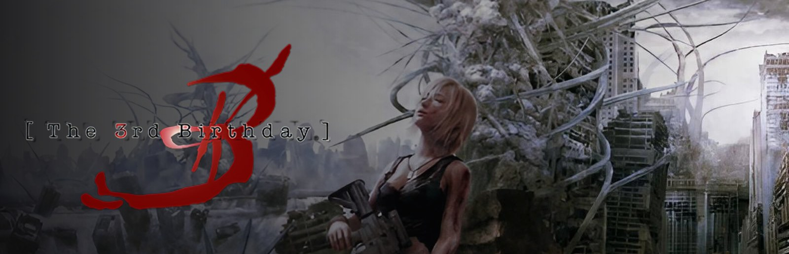

**Español** · [English](#english) · [Français](#français)

Launcher e instaladores para **Windows y Linux** que convierten **tu copia original** de *The 3rd Birthday* (PSP) en una experiencia de PC sobre PPSSPP: **versión en español con voces japonesas integrada**, **gráficos y texturas en HD**, **iconos de mando Xbox o de teclado y ratón dentro del juego**, **cámara libre** con ratón y stick derecho, menú de pausa y animaciones de inicio y cierre.

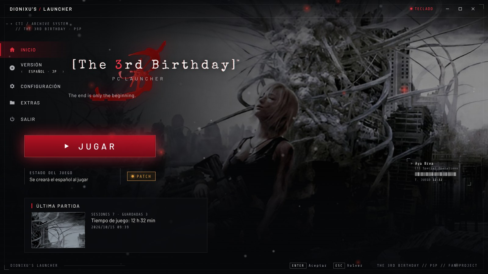

---

## ⚠️ Aviso legal

- Este proyecto **NO incluye el juego**.
- Necesitas **tu propia copia original** de *The 3rd Birthday* para PSP, copiada por ti de tu UMD. **Elige la que prefieras (o las dos):**
  - **Versión americana (USA), `ULUS-10567`** → juegas en **inglés** y, con el parche integrado, en **español con voces japonesas (UNDUB)**.
  - **Versión japonesa, `ULJM-05798`** → juegas en **japonés**, tal como salió en Japón.
- El instalador comprueba la huella MD5 (Redump) de tu ISO y **solo funciona con tu copia oficial sin modificar**. No se aceptan CSO ni ISOs ya parcheadas. La versión europea no sirve para este instalador.
- **No se acepta ni se fomenta la piratería.** No descargues ni compartas imágenes de juegos.
- Proyecto de aficionados sin fines de lucro, **sin relación con Square Enix**. *The 3rd Birthday* © 2010–2011 Square Enix Co., Ltd. Si los titulares de los derechos lo piden, el contenido correspondiente se retirará.

## 🇪🇸 Español con voces japonesas, integrado

El instalador genera la versión en español **a partir de tu ISO americana** (parche xdelta verificado por MD5): texto en español de **Traducciones del Tío Victor** y voces originales en japonés (UNDUB). Tu ISO original no se modifica. No necesitas parchear nada a mano.

## ✨ Mejoras visuales y texturas

- **Resolución interna** de 720p a **4K** (×3 a ×8).
- **Mejora de texturas por GPU** (Vulkan): 4xBRZ (nítido), MMPX (pixel art) o suave; deposterizado. En DirectX 11 / OpenGL, por CPU.
- **Texto, HUD y botones redibujados en HD** (×4): la fuente del juego, el atlas del HUD y la pantalla de aviso, sin pixelado. Para el japonés, un escalado especial para que los kanji no se empasten.
- **Iconos de botones de mando Xbox o de teclado y ratón** dentro del juego (menús, mensajes, HUD y aviso inicial). Con teclado, **los iconos muestran tus teclas** tal como las tengas asignadas.
- Filtros de imagen opcionales (nitidez, FXAA, color natural), antialiasing y filtrado anisotrópico.

| Texto en HD | Iconos Xbox / teclado |
|---|---|
| 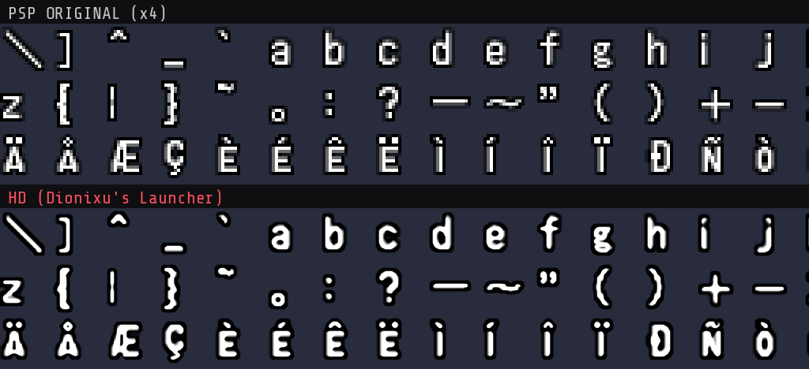 | 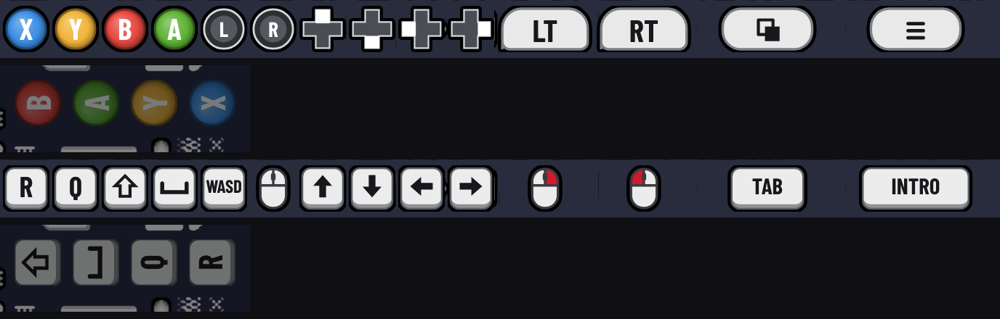 |

## 🏆 Logros (RetroAchievements)

Los **74 logros oficiales** de RetroAchievements (set de **zizom**), evaluados **sin conexión** por el launcher, también en la **versión en español (UNDUB)**, que el servidor no acepta. Inicia sesión una vez en *Extras → LOGROS* para descargar la lista y los iconos (no se guarda tu contraseña). Aviso en pantalla con icono y puntos, progreso y textos traducidos al español. Se guardan en el launcher, no en tu perfil de RetroAchievements. La versión japonesa no tiene logros.

## Funciones

- Launcher con la estética del juego (archivo del CTI), **animación OVERDIVE** al jugar y cierre tipo CRT; en **español e inglés**.
- Elige versión: **Español (UNDUB)**, **English** o **日本語**, según las copias que tengas.
- **Cámara libre** con ratón y stick derecho (Windows), en las tres versiones. Al apuntar manda la cámara del juego.
- Mando Xbox y teclado/ratón, **controles editables**; ESC o **L3 + R3** = menú de pausa con volumen en vivo (Windows).
- Pantalla completa, ventana o sin bordes; motor Vulkan, DirectX 11 u OpenGL.
- **Motor de mods**: carpeta `mods\` con texturas, trucos CWCheat y ajustes de PPSSPP.
- Galería de capturas, tiempo de juego, cursor propio y **`AGREGAR_A_STEAM`** para añadirlo a Steam con su arte (Windows **y Linux**).

## Capturas

| Launcher | |
|---|---|
| 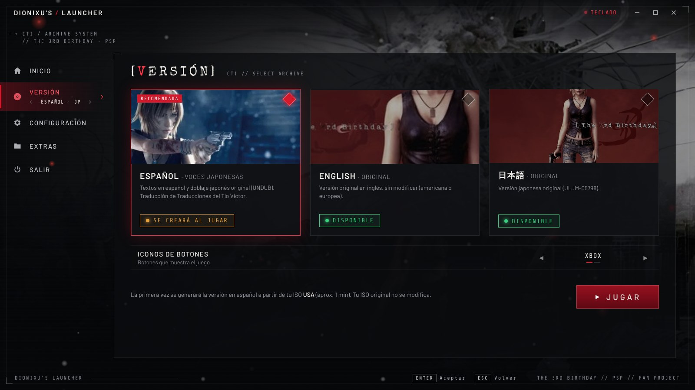 | 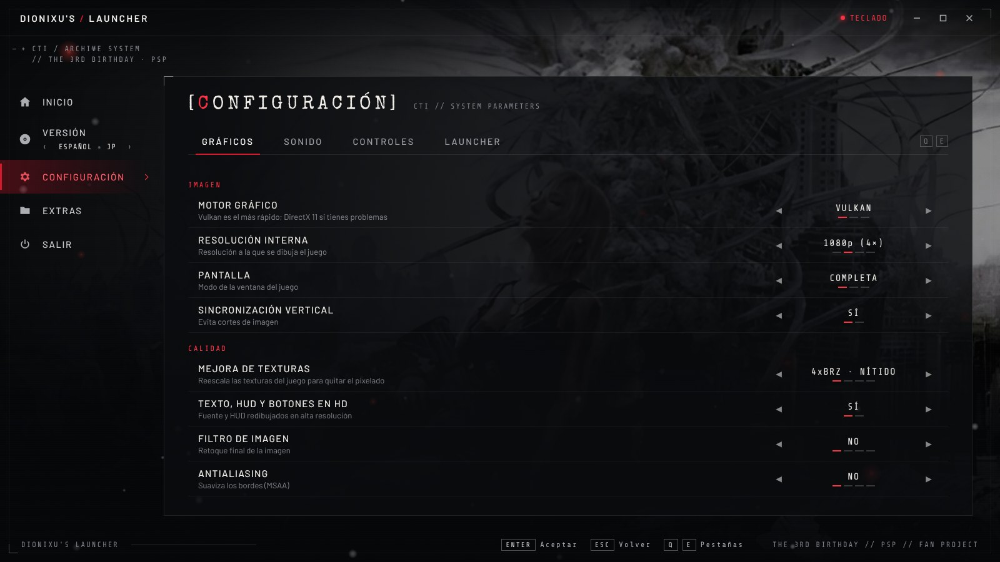 |
| 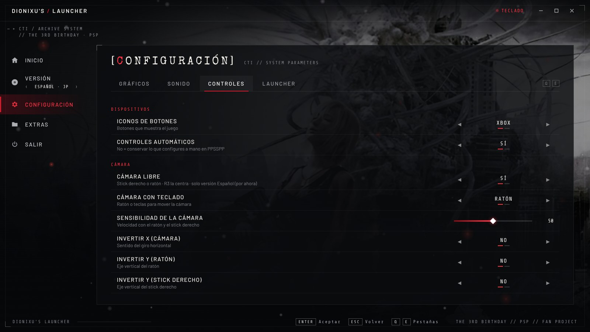 | 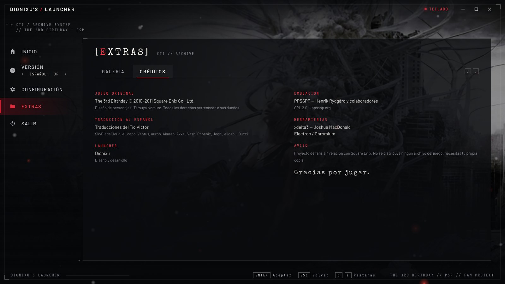 |

| Instalador | |
|---|---|
| 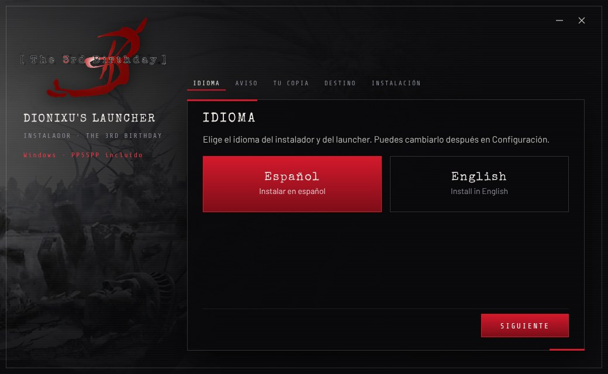 | 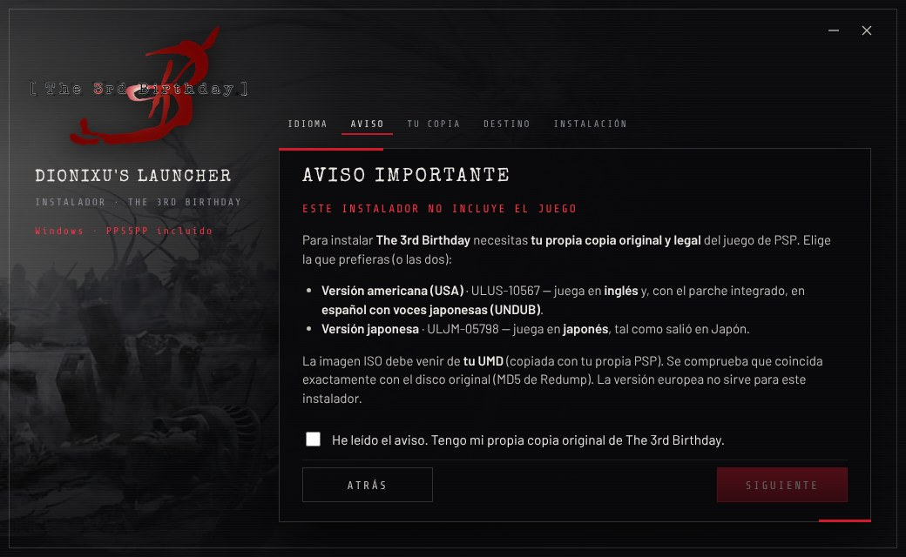 |
| 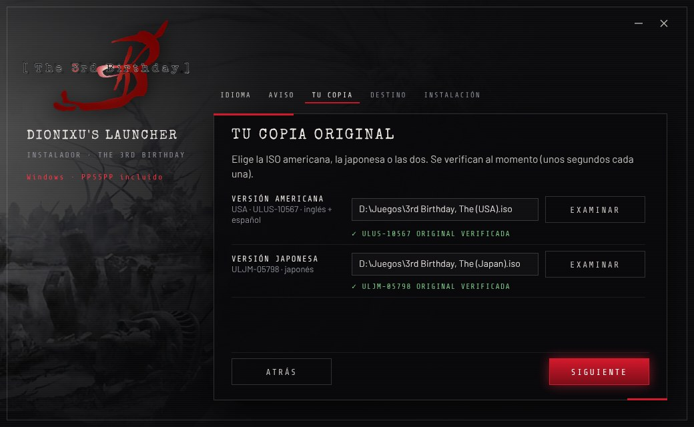 | 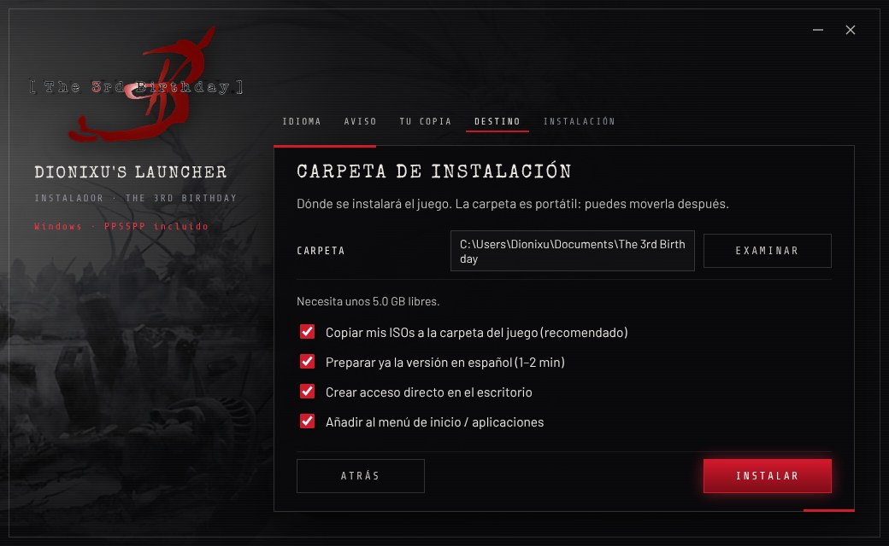 |
| 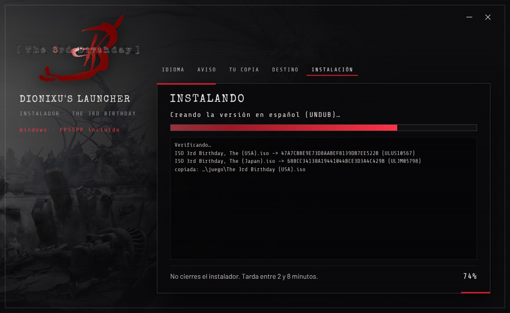 | |

## Descargas

En **[Releases](../../releases/latest)**:
- **Windows 10/11 (64 bits):** `The_3rd_Birthday_Instalador_Windows_vX.Y.Z.zip` — PPSSPP incluido.
- **Linux:** `Instalar_The_3rd_Birthday-x86_64.AppImage` — usa tu PPSSPP (Flatpak recomendado).

## Instalación

### Windows (10 u 11, 64 bits)
1. Descomprime **todo** el `.zip` y abre `Instalar The 3rd Birthday.exe`. Si SmartScreen avisa: *Más información → Ejecutar de todas formas* (no está firmado).
2. Elige tu ISO americana, japonesa o las dos; se verifican al momento.
3. Elige la carpeta y pulsa **INSTALAR** (2–8 min). Se crea la versión en español si diste la americana.
4. **Steam:** en la carpeta instalada, doble clic en `AGREGAR_A_STEAM.bat`.

### Linux (AppImage)
1. Instala PPSSPP: `flatpak install flathub org.ppsspp.PPSSPP` (o el paquete `ppsspp` de tu distribución).
2. `chmod +x Instalar_The_3rd_Birthday-x86_64.AppImage` y ábrelo (sin FUSE: `--appimage-extract-and-run`).
3. Elige tu ISO y la carpeta (por defecto `~/Games/The 3rd Birthday`) y pulsa **INSTALAR**.
4. **Steam / Steam Deck:** en la carpeta instalada ejecuta `./agregar_a_steam.sh` (el `.bat` es solo de Windows; este script hace lo mismo con Python 3).

> En Linux todavía no están la cámara libre, el menú de pausa con ESC / L3+R3 ni el volumen en vivo (usan APIs de Windows). Todo lo demás funciona igual.

### Problemas
- Envía el `instalacion.log` de la carpeta de instalación o `launcher/data/launcher.log`.
- Si el mando no responde desde Steam: *Propiedades → Mando → Desactivar Steam Input*.

## Compilación (para desarrolladores)

Los instaladores se generan con **GitHub Actions** (`.github/workflows/build.yml`) al cambiar `VERSION` o crear una etiqueta `v*`:
- Windows: Electron + `rcedit`, PPSSPP portable, `xdelta3.exe`, parche, scripts de Steam → `.zip`.
- Linux: AppImage armado con `instalador/build/appimage.js` (squashfs + runtime, en JavaScript), con `xdelta3`.
- El parche al español está en `parche/partes/` (trozos de 95 MB, GitHub no admite archivos de más de 100 MB) y se une y verifica por MD5 al compilar.

Estructura: `launcher/` (launcher Electron: `resources/app/main.js`, `bridge.ps1` y `ui/`), `instalador/` (asistente), `steam/`, `herramientas/` (texturas HD y cámara libre: `hd_base.py`, `camara_libre.s`), `scripts/` (herramientas de desarrollo en Windows), `docs/PROYECTO_NOTAS.md` (bitácora técnica).

## Créditos

- **Dionixu** ([@kaiwolft](https://github.com/kaiwolft)) — idea, diseño, pruebas y desarrollo del launcher.
- Desarrollado junto a **Claude** (Anthropic).
- **daetrox** ([@daetrox](https://github.com/daetrox)) — correcciones para Linux en los launchers de Dionixu.
- **Logros:** set de RetroAchievements por **zizom** · [rcheevos](https://github.com/RetroAchievements/rcheevos) (MIT).
- **Traducción al español:** Traducciones del Tío Victor — SkyBladeCloud, el_capo, Ventus, auron, Akareh, Axxel, Vash, Phoenix, Joghi, eliden, IlDucci.
- **Texturas HD e iconos de botones:** generados para este launcher (Dionixu y Claude) a partir de las texturas del juego.
- **Música y efectos del launcher:** creados para este launcher.
- **PPSSPP** — Henrik Rydgård y colaboradores (GPL 2.0+) · **xdelta3** — Joshua MacDonald · **Electron / Chromium**.
- Tipografías (SIL OFL): Special Elite (Astigmatic), Share Tech Mono (Carrois), Barlow y Barlow Condensed (Jeremy Tribby).
- *The 3rd Birthday* © 2010–2011 Square Enix Co., Ltd. Diseño de personajes: Tetsuya Nomura. Todos los derechos pertenecen a sus dueños; el contenido se retirará si lo piden.

## ☕ Apoyo

Si te gusta el proyecto, puedes invitarme un café en **[Ko-fi](https://ko-fi.com/dionixu838824)**. ¡Gracias!

---

## English

The 3rd Birthday Launcher turns **your own original copy** of *The 3rd Birthday* (PSP) into a PC experience on top of PPSSPP, for **Windows and Linux**: **built-in Spanish version with Japanese voices**, **HD graphics and textures**, **Xbox or keyboard & mouse button prompts in game**, **free camera** with mouse and right stick, pause menu and intro/outro animations.

### ⚠️ Legal notice
- This project **does NOT include the game**. You need **your own original copy**, dumped from your UMD. **Pick whichever you prefer (or both):**
  - **US version, `ULUS-10567`** → play in **English** and, with the built-in patch, in **Spanish with Japanese voices (UNDUB)**.
  - **Japanese version, `ULJM-05798`** → play in **Japanese**.
- The installer checks your ISO's MD5 (Redump) and **only works with your unmodified official copy**. CSO and patched ISOs are not accepted; the European version is not supported by this installer.
- **No piracy.** Do not download or share game images. Non-profit fan project, **not affiliated with Square Enix**. Content will be removed if the rights holders ask.

### ✨ Visual upgrades and textures
- Internal resolution from 720p up to **4K**; **GPU texture upscaling** (4xBRZ, MMPX or smooth) with deposterize.
- **Font, HUD and button prompts redrawn in HD** (×4), including the startup notice; special scaling so Japanese kanji stay clean.
- **Xbox or keyboard & mouse prompts in game** — the keyboard prompts show **your own key bindings**.
- Optional image filters (sharpen, FXAA, natural colors), anti-aliasing and anisotropic filtering.

### 🏆 Achievements
The **74 official RetroAchievements** (set by **zizom**), checked **offline** by the launcher — also in the Spanish UNDUB version, which the server does not accept. Sign in once in *Extras → ACHIEVEMENTS* to download the list and icons (your password is not stored). On-screen notice with icon and points, progress tracking. Stored in the launcher, not on your RetroAchievements profile. The Japanese version has no achievements.

### Features
- Game-themed launcher (CTI archive) with OVERDIVE launch animation, in Spanish and English; choose **Spanish (UNDUB)**, **English** or **Japanese**.
- **Free camera** with mouse and right stick (Windows, all versions); editable controls; ESC or **L3 + R3** pause menu with live volume (Windows).
- Fullscreen / windowed / borderless; Vulkan, DirectX 11 or OpenGL; **mods** folder (textures, CWCheat cheats, PPSSPP settings); screenshots gallery; **Add to Steam** scripts with artwork (Windows **and Linux**).

### Installation
- **Windows 10/11:** extract the whole `.zip`, open `Instalar The 3rd Birthday.exe` (SmartScreen: *More info → Run anyway*), choose your ISO(s) and folder. PPSSPP is included. Steam: `AGREGAR_A_STEAM.bat`.
- **Linux:** install PPSSPP (`flatpak install flathub org.ppsspp.PPSSPP`), `chmod +x` the AppImage and run it. Steam / Steam Deck: `./agregar_a_steam.sh` in the installed folder (the `.bat` is Windows-only; this script does the same with Python 3).
- On Linux the free camera, the ESC / L3+R3 pause menu and live volume are not available yet (they use Windows APIs).

### Building
GitHub Actions builds both installers when `VERSION` changes or a `v*` tag is pushed. The Spanish patch lives in `parche/partes/` (95 MB parts) and is joined and MD5-checked at build time.

### Credits
Dionixu ([@kaiwolft](https://github.com/kaiwolft)) — author · developed together with **Claude** (Anthropic) · daetrox ([@daetrox](https://github.com/daetrox)) — Linux fixes · achievement set by zizom (RetroAchievements) · Spanish translation: Traducciones del Tío Victor (SkyBladeCloud, el_capo, Ventus, auron, Akareh, Axxel, Vash, Phoenix, Joghi, eliden, IlDucci) · HD textures, prompts, launcher music and sounds made for this launcher · PPSSPP (Henrik Rydgård and contributors, GPL 2.0+) · xdelta3 (Joshua MacDonald) · Electron · fonts under SIL OFL (Special Elite, Share Tech Mono, Barlow). *The 3rd Birthday* © 2010–2011 Square Enix Co., Ltd.

### ☕ Support
[Ko-fi](https://ko-fi.com/dionixu838824) — thank you!

---

## Français

The 3rd Birthday Launcher transforme **votre propre copie originale** de *The 3rd Birthday* (PSP) en une expérience PC basée sur PPSSPP, pour **Windows et Linux** : **version espagnole avec voix japonaises intégrée**, **graphismes et textures HD**, **icônes de manette Xbox ou clavier/souris dans le jeu**, **caméra libre** à la souris et au stick droit, menu pause et animations.

### ⚠️ Avis légal
- Ce projet **n'inclut PAS le jeu**. Il vous faut **votre propre copie originale**, extraite de votre UMD. **Au choix (ou les deux) :**
  - **Version américaine, `ULUS-10567`** → jouez en **anglais** et, grâce au patch intégré, en **espagnol avec voix japonaises (UNDUB)**.
  - **Version japonaise, `ULJM-05798`** → jouez en **japonais**.
- L'installateur vérifie l'empreinte MD5 (Redump) de votre ISO et **ne fonctionne qu'avec votre copie officielle non modifiée**.
- **Non au piratage.** Projet de fans à but non lucratif, **sans lien avec Square Enix**. Le contenu sera retiré à la demande des ayants droit.

### ✨ Améliorations visuelles
Résolution interne jusqu'en **4K**, **mise à l'échelle des textures par GPU** (4xBRZ, MMPX), **police, HUD et icônes redessinés en HD**, **icônes Xbox ou clavier/souris** (avec vos propres touches), filtres d'image optionnels.

### 🏆 Succès
Les **74 succès officiels** de RetroAchievements (set de **zizom**), vérifiés **hors ligne** par le launcher, y compris dans la version espagnole (UNDUB). Connectez-vous une fois dans *Extras → LOGROS* pour télécharger la liste. Ils sont enregistrés dans le launcher, pas sur votre profil RetroAchievements.

### Installation
- **Windows 10/11 :** décompressez tout le `.zip`, ouvrez `Instalar The 3rd Birthday.exe`, choisissez votre/vos ISO et le dossier. PPSSPP est inclus. Steam : `AGREGAR_A_STEAM.bat`.
- **Linux :** installez PPSSPP (`flatpak install flathub org.ppsspp.PPSSPP`), rendez l'AppImage exécutable et lancez-la. Steam / Steam Deck : `./agregar_a_steam.sh` dans le dossier installé.
- Sous Linux, la caméra libre, le menu pause ESC / L3+R3 et le volume en direct ne sont pas encore disponibles.

### Crédits
Dionixu ([@kaiwolft](https://github.com/kaiwolft)) — auteur · développé avec **Claude** (Anthropic) · daetrox ([@daetrox](https://github.com/daetrox)) — corrections Linux · traduction espagnole : Traducciones del Tío Victor · PPSSPP, xdelta3, Electron, polices SIL OFL. *The 3rd Birthday* © 2010–2011 Square Enix Co., Ltd.

### ☕ Soutien
[Ko-fi](https://ko-fi.com/dionixu838824) — merci !
